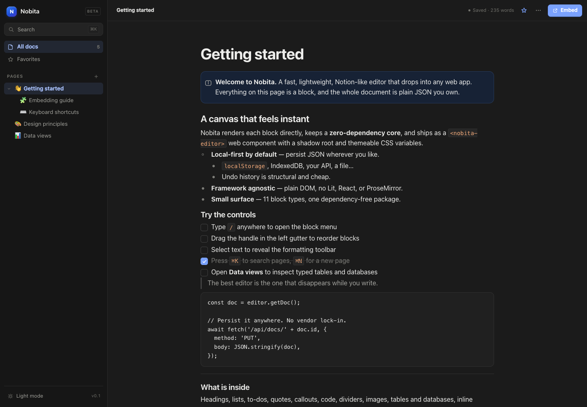
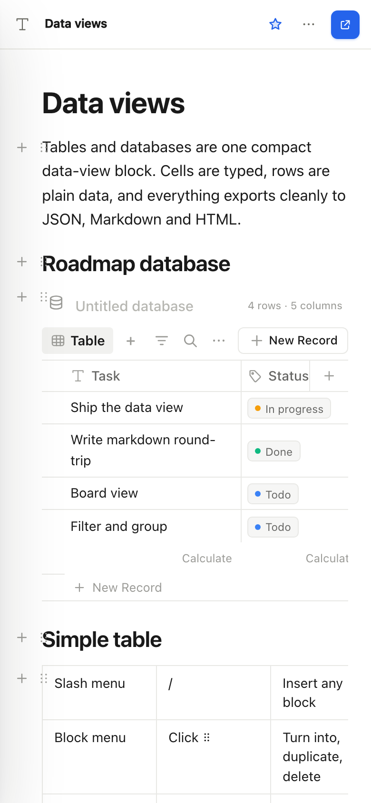

# Nobita

**A fast, lightweight, Notion-like block editor you can embed anywhere.**

Nobita is a from-scratch block editor built with **TypeScript 7.0.2**. It takes the interaction model people know from Notion and AFFiNE — blocks, a slash menu, a hover gutter, drag to reorder, markdown shortcuts — and packages it as a small, framework-free web component with plain JSON documents.

<p>
  
  
</p>
<p>
  
</p>
<p>
  
</p>

- **114.6 kB gzipped** standalone ESM editor, including the document model, rich-text tables, database views and virtualized rendering.
- **Zero external runtime dependencies** for the core and standalone editor. React, Yjs and Automerge integrations are optional packages.
- **Shadow DOM web component** — host styles cannot leak in, editor styles cannot leak out.
- **Plain JSON documents** — persist to localStorage, IndexedDB, your API, or a file.
- **Framework agnostic** — vanilla API, `<nobita-editor>`, and a thin React wrapper.
- **AFFiNE-informed, not an AFFiNE port** — see [the analysis](docs/affine-analysis.md).

## What works today

| Area | Included |
| --- | --- |
| Blocks | Text, headings 1–6, bulleted / numbered / to-do lists, quote, callout, code, divider, image, simple table, database, page links, optional [table of contents](docs/public-api.md#table-of-contents) |
| Inline | Bold, italic, underline, strikethrough, inline code, links, mentions, `[[` inline page chips, alignment, 8-color highlight and text-color palettes |
| Editing | Enter / Backspace / Delete merging, Tab indent, block move, undo / redo, block selection (`Escape`, gutter `Shift`/`Cmd`-click, staged `Cmd/Ctrl+A`, `Shift+Arrow`, batch delete / duplicate / copy / paste / drag across text & non-text blocks) |
| Tables | Separate `table` block with AFFiNE-style hover handles, row/column drag reorder, cell merging and splitting, rich-text cells (`cell.runs`), drag cell selection (copy/cut/paste/clear), hover add controls, row/column background colors, cell & handle right-click context menus, and HTML/Markdown table import |
| Data views | Multiple named table and board views per database, AFFiNE-style view settings (`⋯`), per-view column order/widths/visibility, nested AND/OR filters, multi-sort, container-aware expandable search (auto-hidden below `560px`), footer statistics, sticky add-column/new-record controls, table grouping/collapse with persisted group state; rich-text cells (`B`/`I`/`U`/`S`/code toolbar & shortcuts, highlight/color rendering, IME & plain-text paste safe), editable record pages (`row.page.content`), board card covers (`coverColumnId`), board card add/open/drag-reorder/group actions (preserving multi-select tags), right-click menus on rows/columns/board cards, drag cell selection & fill, TSV copy/paste, readonly view switching & record-page viewing; 13 column types including formulas and bidirectional relations |
| Menus | Slash menu with fuzzy search and block/page actions (move/copy/link/new page), block handle & Notion-style right-click context menus (single/multi-block, simple tables, database rows/columns/board cards; `Shift+Right-click` preserves native menu), selection toolbar with Turn into / Align / format / Color, link popover, `@` mention picker, `[[` page link picker |
| Host extensions | [Custom block renderers and slash commands](#host-defined-blocks) with portable JSON payloads, [per-editor UI dictionaries](#ui-dictionaries) and an optional Japanese locale |
| Workspace | Pure DOM-free `@nobita/core` primitives for backlinks, cycle-safe page trees, breadcrumbs, reparenting, full-text search, and soft-delete Trash; wired into `apps/demo` with drag-and-drop sidebar tree, collapsible backlinks panel, Trash view (search, read-only preview banner, Undo toast, restore & permanent delete), and sidebar right-click menus |
| Drag | Reorder blocks, drop between blocks or nest into a block |
| Markdown | `# `, `- `, `1. `, `[] `, `> `, ` ``` `, `--- `, Markdown tables; inline `**bold**`, `*italic*`, `` `code` ``, `~~strike~~`, `[links](url)` |
| Clipboard | Rich HTML, Markdown, plain text, a private `application/x-nobita+json` format, and image paste through an upload adapter |
| Long documents | Windowed rendering, selection across unmounted blocks, IME input, nested-block navigation and full-document printing |
| Collaboration | Optional Yjs and Automerge adapters for concurrent edits, offline merging, local Undo/Redo and remote selections |
| Persistence | JSON in / JSON out, `onChange`, `setDoc`, readonly mode (read-only view switching and record pages in databases), theming; optional `@nobita/storage` adapters for localStorage, SQLite/D1 and HTTP |
| A11y | Keyboard menus and row/card actions (`Mod+Enter` opens record pages), record-page modal focus trap & focus restoration, `:focus-visible` outlines, `aria-pressed` / `data-active` formatting toolbars, `@media (hover: none)` touch controls |

## Quick start

```bash
pnpm install
pnpm dev          # demo at http://127.0.0.1:5173
pnpm test         # core, storage, and collaboration adapter tests
pnpm typecheck    # TypeScript 7 project build
pnpm build        # packages + bundled editor + demo
```

### Web component

```html
<script type="module">
  import '@nobita/element'; // auto-defines <nobita-editor>

  const editor = document.querySelector('nobita-editor');
  editor.doc = await fetch('/doc.json').then(response => response.json());

  editor.addEventListener('nobita-change', event => {
    save(event.detail.doc);
  });
</script>

<nobita-editor theme="auto" placeholder="Type '/' for commands"></nobita-editor>
```

`packages/element/dist/nobita.js` is the standalone ESM build. `dist/nobita.global.js` is an IIFE for a plain `<script>` tag and exposes `window.Nobita`.

### Imperative API

```ts
import { createEditor } from '@nobita/element';
import type { Doc } from '@nobita/core';

const editor = createEditor(document.querySelector('#editor')!, {
  doc: await fetch('/doc.json').then(response => response.json()) as Doc,
  theme: 'light',
  placeholder: "Type '/' for commands",
  onChange(doc, meta) {
    localStorage.setItem('nobita-doc', JSON.stringify(doc));
  },
  onSelectionChange(selection) {
    console.log(selection);
  },
});

editor.focus();
editor.insertMarkdown('## Pasted markdown\n\n- becomes\n- blocks');
```

Documents with at least 300 top-level blocks render the visible window plus 800 px of overscan on each side. Pass `virtualize: { threshold, overscanPx }` to `createEditor` to tune the window, or `virtualize: false` to render every block. Search the document model and use `editor.scrollToBlock(id)` to reveal a result.

### React

```tsx
import { useRef } from 'react';
import { NobitaEditor, type NobitaReactHandle } from '@nobita/react';

export function Document() {
  const editor = useRef<NobitaReactHandle>(null);

  return (
    <NobitaEditor
      ref={editor}
      theme="auto"
      minHeight="480px"
      doc={initialDoc}
      onChange={doc => save(doc)}
    />
  );
}
```

The React wrapper only manages the host element; React never renders a block. That keeps typing off the React render path.

### Collaborative editing

Install either `@nobita/collab-yjs` with `yjs`, or `@nobita/collab-automerge` with `@automerge/automerge`. Initialize the document once and share its CRDT history with subsequent replicas. The host provides the transport. Use the same adapter version on all connected clients. This version reads older paragraph splits and upgrades their boundaries on the first local edit.

```ts
import * as Y from 'yjs';
import { YjsCollaborationAdapter } from '@nobita/collab-yjs';

const shared = new Y.Doc();
const adapter = new YjsCollaborationAdapter(shared, editor.doc);
await editor.setCollaboration(adapter);
// Send Yjs updates through your provider. Peers open the synchronized Y.Doc.
await editor.setCollaboration(null);
adapter.destroy();
```

For Automerge, construct the first `AutomergeCollaborationAdapter` with a Nobita document. Pass its `save()` bytes to the constructor on another client. Deliver subsequent snapshots to `receive(bytes)` to merge offline edits. Both adapters support local Undo/Redo. Connecting and disconnecting start a fresh editor history. While connected, replacing the current document with the same document ID synchronizes the replacement. Disconnect before opening a different document ID.

The editor options, custom element, and React wrapper accept a `collaboration` property. Await `editor.collaborationReady` before issuing programmatic edits after a property change. For standalone deployments, serve `dist/collaboration.js` alongside `nobita.js` or `nobita.global.js`. Collaboration loads this module on demand.

For remote selections, pass `awarenessPresence(awareness, user)` to the Yjs adapter or provide a presence channel with `publish`, `subscribe`, and an optional local `user` to either adapter. The host owns the adapter and can reuse it after detaching the editor.

## Storage

Hosts can read and write plain JSON documents through the editor API. Persistence adapters are packaged separately.

`@nobita/storage` is an optional package for hosts that want a ready-made persistence port:

| Adapter | Use |
| --- | --- |
| `MemoryDocumentStore` | Tests, previews, ephemeral sessions |
| `LocalStorageDocumentStore` | `localStorage` / `sessionStorage` |
| `HttpDocumentStore` | Your API, including the Cloudflare D1 example |
| `SqlDocumentStore` | Local SQLite and Cloudflare D1 through a small `SqlDriver` |

```ts
import { LocalStorageDocumentStore } from '@nobita/storage';

const store = new LocalStorageDocumentStore();
const stored = await store.load('page-id');
await store.save(editor.getDoc(), {
  version: stored?.version ?? 0,
});
```

`version: 0` creates a document, a positive version enforces optimistic concurrency, and omitting it does a last-write-wins save. Each document stays one JSON value.

For Cloudflare D1, [examples/cloudflare-d1](examples/cloudflare-d1) contains a Worker, schema, D1 driver and browser client. Deployment steps and D1 limits are in [docs/storage.md](docs/storage.md).

## Document model

A document is deliberately simple, stable JSON:

```json
{
  "version": 1,
  "id": "d3f8k2",
  "title": "Hello",
  "icon": "👋",
  "blocks": [
    {
      "id": "b7k2m1",
      "type": "paragraph",
      "text": [
        { "text": "Hello " },
        { "text": "world", "marks": { "bold": true } }
      ],
      "props": {},
      "children": []
    }
  ]
}
```

- `text` is an array of runs. Each run has `text` and optional `marks`.
- `children` is a tree, used by nested lists and callouts.
- `props` is small and typed: heading `level`, todo `checked`, code `language`, callout `tone`, image `src` / `caption`, table `table`, database `database`, alignment, collapsed state.
- `parseDoc()` validates unknown JSON before it reaches the editor, deduplicates block ids, and fills defaults.

### Data views

**Table** and **Database** are separate blocks.

- A `table` block is a simple editable grid (`props.table`). It follows AFFiNE's table model: row/column handles sit on the first cell edges (click or right-click for menus, drag to reorder rows/columns), cells support inline rich-text formatting (`cell.runs` with `cell.text` plain projection and HTML/Markdown table round-trip) and cell right-click context menus, drag selection covers multiple cells (copy, cut, paste and clear), hover plus controls add rows/columns, and row/column background colors are available. It has no properties or views.
- A `database` block is the typed data view (`props.database`). It has typed columns, row records and one or more named views.

A **Relation** property links rows by ID. Select the target database in the property settings, then click a cell to search for rows. Select a reverse relation property to keep both ends in sync in one undo step. The target can be the same database.

A **Formula** property computes a read-only value for each row. Click a formula cell to edit its expression. For example, `sum(pluck(prop("Tasks"), "Hours"))` totals hours from linked tasks. The editor saves column IDs so renaming either property preserves the formula. Sorting, filtering, searching, statistics and exports use calculated values. The document stores the expression and row links.

For targets outside the document, provide `databaseProvider(query)` for discovery and `resolveDatabase(databaseId, pageId)` for synchronous lookup. Replace the resolved snapshot and call `editor.refreshDatabases()` when it changes. Use `onRelationSync(change)` to apply paired link changes in the target document.

```json
{
  "type": "database",
  "text": [],
  "props": {
    "database": {
      "variant": "database",
      "title": "Tasks",
      "columns": [
        { "id": "c1", "name": "Task", "type": "text" },
        { "id": "c2", "name": "Status", "type": "select", "options": ["Todo", "Done"] },
        { "id": "c3", "name": "Due", "type": "date" },
        { "id": "c4", "name": "Done", "type": "checkbox" }
      ],
      "rows": [
        {
          "id": "r1",
          "cells": {
            "c1": {
              "text": "Ship it",
              "runs": [
                { "text": "Ship", "marks": { "bold": true } },
                { "text": " it" }
              ]
            },
            "c2": { "text": "Done" },
            "c3": { "text": "2026-12-01" },
            "c4": { "checked": true }
          },
          "page": {
            "content": [{ "text": "Release checklist and notes." }]
          }
        }
      ],
      "views": [
        {
          "id": "v1",
          "name": "Table",
          "type": "table",
          "columns": [
            { "id": "c1", "width": 200 },
            { "id": "c2", "width": 130 },
            { "id": "c3", "width": 120 },
            { "id": "c4", "width": 86, "stat": "checked" }
          ],
          "sorts": [{ "columnId": "c3", "direction": "asc" }]
        },
        {
          "id": "v2",
          "name": "Board",
          "type": "board",
          "groupBy": "c2",
          "groupProperties": [
            { "key": "Done", "manuallyCardSort": ["r1"] }
          ],
          "filter": {
            "mode": "and",
            "conditions": [{ "columnId": "c2", "operator": "is", "value": "Done" }]
          }
        }
      ],
      "activeViewId": "v1"
    }
  },
  "children": []
}
```

Column types are `text`, `number`, `progress`, `select`, `multi-select`, `date`, `checkbox`, `url`, `image`, `files`, `people`, `relation` and `formula`. Text cells store optional rich-text `runs` alongside the plain `text` projection (used for search, filtering, sorting, statistics and TSV/Markdown export), `progress` renders an interactive 0–100% bar, `image` supports validated URLs or the host `uploadImage` adapter with Board card covers (`view.coverColumnId`), and empty cells are omitted so documents stay compact. Rows can also carry an optional rich-text `page.content` body edited inside the record page panel, and rows, column headers, and board cards support right-click context menus. Each view stores its own column layout (order, width, visibility and footer stat), nested `filter` tree, `sorts`, `groupBy` and `groupProperties` (group order, hidden/collapsed state and `manuallyCardSort`). Markdown/HTML tables import as simple tables; TSV paste fills database cells. Legacy documents with a single `view`, `sort`, flat `filters` or `hiddenColumns` still load and migrate on the next edit.

Simple tables support merged cells. Select a rectangular range by dragging or Shift-clicking, then choose **Merge cells** from the context menu. Use **Split cell** to restore the cells. From the keyboard, extend the range with Shift+Arrow at a cell boundary and open the menu with Shift+F10. HTML preserves spans. Markdown and TSV keep the anchor text and leave covered positions empty. The combined text, including the newline between nonempty cells, must fit within 10,000 UTF-16 code units.

## API

See [docs/public-api.md](docs/public-api.md) for the stable import surface, editor options, events and internal-module boundary.

### `NobitaEditor`

| Member | Description |
| --- | --- |
| `getDoc()` | Current immutable document |
| `getJSON(pretty?)` | Serialize the document |
| `getMarkdown()` / `getHTML()` | Export helpers |
| `setDoc(doc, { history? })` | Replace the document |
| `registerSlashBlock(command)` | Offer a host-defined block in the slash menu of an empty paragraph. Returns an unregister function. [Ticket card example](examples/ticket-card/) |
| `registerCustomBlock(type, renderer)` | Register an editor-local renderer for a `custom:` block. Clients without the renderer retain its JSON payload. [Usage](docs/public-api.md#host-defined-blocks) |
| `setTitle(title)` | Update only the title |
| `getSelection()` | Current block/offset selection or `null` |
| `getSelectedBlockIds()` | Currently selected block IDs (block selection mode) |
| `selectBlocks(ids)` / `clearBlockSelection()` | Programmatically set or clear block selection |
| `focus(blockId?, offset?)` | Focus the editor or a block, mounting it if needed |
| `scrollToBlock(blockId)` | Reveal a block without moving the caret. Returns whether it was found |
| `setCollaboration(adapter)` / `setCollaboration(null)` | Connect or disconnect a collaboration adapter asynchronously |
| `refreshDatabases()` | Refresh local views after a host-provided database snapshot changes |
| `focusTitle()` / `blur()` | Focus control |
| `undo()` / `redo()` | History |
| `setReadonly(value)` / `setTheme(theme)` / `setPlaceholder(value)` | Runtime configuration |
| `insertMarkdown(markdown)` | Insert blocks at the caret |
| `getBlockLink(blockId)` | Return the stable `#block-…` link for a block |
| `insertPageLink(page, { afterBlockId? })` | Insert a block-level reference card to a host-owned page |
| `insertInlinePageLink(page)` | Insert an atomic inline page link chip at the selection |
| `refreshPageLinks()` | Re-read optional page metadata for cards and inline chips after a rename |
| `setMentionProvider(provider)` | Replace the mention directory at runtime |
| `setPageProvider(provider)` | Replace the `[[` / `/page` page directory at runtime |
| `setUploadImage(handler)` | Replace the image upload adapter at runtime |
| `destroy()` | Remove listeners and DOM |

Options include `dictionary`, `virtualize`, `collaboration`, `databaseProvider`, `resolveDatabase`, `onRelationSync`, `doc`, `readonly`, `theme` (`light` / `dark` / `auto`), `placeholder`, `autofocus`, `spellcheck`, `historyLimit`, `onChange(doc, { source })`, `onSelectionChange(selection)`, `mentionProvider`, `pageProvider`, `uploadImage`, `onOpenPage`, `resolvePage`.

### Host-defined blocks

Use `registerCustomBlock` to render a saved block and `registerSlashBlock` to let users insert a new one. Both registrations belong to one editor. This example adds a ticket card command labeled 案件カード to an editor mounted in `<div id="tickets"></div>`.

```ts
import { createBlock, createDoc } from '@nobita/core';
import { createEditor } from '@nobita/element';

const editor = createEditor(document.querySelector<HTMLElement>('#tickets')!, {
  doc: createDoc({ blocks: [createBlock('paragraph')] }),
});

editor.registerCustomBlock('custom:ticket', block => {
  const data = block.props.data;
  if (data && typeof data === 'object' && 'number' in data && typeof data.number === 'string') {
    return `案件（${data.number}）`;
  }
  return '案件カード';
});

const unregister = editor.registerSlashBlock({
  id: 'acme.insert-ticket',
  label: '案件カード',
  keywords: ['案件', 'ticket'],
  create: () => createBlock('custom:ticket', {
    text: '案件（未採番）',
    props: { data: { version: 1, number: '未採番', status: 'open' } },
  }),
});
```

Type `/案件` or `/ticket` in an empty paragraph with no children and select **案件カード**. The synchronous factory creates a fresh block on selection. The caret moves to the empty paragraph after the card, ready for typing. One Undo restores the original empty paragraph. To remove the command, call `unregister()`. Registering the same command ID replaces it, and an earlier disposer leaves the replacement active.

The renderer receives the block and the editor’s read-only flag and can return a DOM node or plain text. Pass `null` as the renderer to unregister it. On a client with custom-block support but no matching renderer, the editor displays the type name. Editing another block and saving as Nobita JSON preserves the custom type, payload, text and children. [Custom block API](docs/public-api.md#host-defined-blocks)

The runnable ticket-card example adds a form for the ticket number and status. Submitting the form commits both fields in one undoable store update. It saves Nobita JSON to localStorage and includes read-only and unregistered modes so you can try the round trip. [Run the example](examples/ticket-card/README.md) · [Host code](examples/ticket-card/host.js)

### UI dictionaries

Pass a partial `NobitaDictionary` to `createEditor` to override menu, toolbar and database labels on one editor. Keys are the original English messages. For example, `{ 'New Record': 'Add ticket' }` changes that label and leaves unspecified labels in English.

For a Japanese UI, import `ja` and override any product-specific terms. The Japanese dictionary is a separate module.

```ts
import { createEditor, type NobitaDictionary } from '@nobita/element';
import { ja } from '@nobita/element/locales/ja';

const dictionary = { ...ja, 'New Record': '案件を追加' } satisfies NobitaDictionary;
createEditor(document.querySelector<HTMLElement>('#editor')!, { dictionary });
```

With `<nobita-editor>`, assign `element.dictionary` before appending the element to the document. Each editor snapshots its dictionary when it mounts. Keep tokens such as `{count}` and `{name}` in overrides. User-entered content, column names and saved view names retain their original values. [Dictionary API](docs/public-api.md#ui-dictionaries)

### Mentions, links and images

Mentions are inline marks, not a separate node type. The host supplies the directory and decides how to resolve `{ id, label, kind }` later:

```ts
editor.mentionProvider = {
  async search(query) {
    const response = await fetch(`/api/people?q=${encodeURIComponent(query)}`);
    return (await response.json()).map((user: { id: string; name: string }) => ({
      id: user.id,
      label: user.name,
      kind: 'user',
    }));
  },
};

editor.uploadImage = async file => {
  const body = new FormData();
  body.append('file', file);
  const response = await fetch('/api/uploads', { method: 'POST', body });
  const result = await response.json();
  return { src: result.url, alt: file.name };
};
```

Typing `@` opens the picker; mention references stay atomic while typing and deleting. `getBlockLink(blockId)` returns `#block-<id>` for links the host can copy; clicking one inside the same document focuses the block. Image paste and drop only run when `uploadImage` is set, and the adapter owns storage, authentication and URL lifetime.

### Page links & workspace primitives

Pages stay separate `Doc`s. The editor supports both block-level page cards (`page` blocks) and atomic inline page chips (`[[` picker / `marks.page`), without loading or embedding target page content:

```ts
editor.pageProvider = {
  search: query => pages.filter(p => p.title.toLowerCase().includes(query.toLowerCase())),
  create: title => createWorkspacePage(title),
};
editor.onOpenPage = pageId => router.open(`/pages/${pageId}`);
editor.resolvePage = pageId => pageCache.get(pageId) ?? null;

// After a host-side rename:
pageCache.set('p1', { id: 'p1', title: 'Product roadmap' });
editor.refreshPageLinks();
```

`@nobita/core` also exports pure, DOM-free workspace helpers (`extractPageLinks`, `buildBacklinkIndex`, `getBacklinks`, `buildPageTree`, `getPageBreadcrumbs`, `canReparentPage`, `isTrashedPage`, `partitionTrashedPages`, `collectTrashTargetIds`, `resolveRestoreParentId`, `collectRestoreTargetIds`, `searchWorkspacePages`) so hosts can build backlinks panels, drag-and-drop page trees, Trash workflows, and full-text search without coupling them to the editor bundle.

The placeholder behaves like AFFiNE: it appears only on the **focused empty paragraph** (or heading, which shows “Heading 1/2/3/4/5/6”), and disappears as soon as text exists or focus leaves the body. It is not shown while the page title is focused. The default is `Type '/' for commands`; set `placeholder` to override the paragraph text.

### `<nobita-editor>`

Attributes: `readonly`, `theme`, `placeholder`, `min-height`, `doc` (JSON string).
Properties: `dictionary` (set before connecting), `collaboration`, `databaseProvider`, `resolveDatabase`, `onRelationSync`, `doc`, `value` (JSON), `markdown`, `editor`, `mentionProvider`, `pageProvider`, `uploadImage`, `onOpenPage`, `resolvePage`.
Methods: `focus()`, `undo()`, `redo()`, `getMarkdown()`, `getJSON()`, `getSelectedBlockIds()`, `selectBlocks()`, `clearBlockSelection()`, `insertPageLink()`, `insertInlinePageLink()`, `refreshPageLinks()`, `setReadonly()`, `setTheme()`.
Events: `nobita-change` (`{ doc, source }`), `nobita-selection` (`{ selection }`), `nobita-page-open` (`{ pageId }`), `nobita-ready`.

Use `doc` as a property for normal use. Set `doc` **before** the element connects, or use the property after mount; the element keeps the last document across disconnect/reconnect.

### Theming

Every visual token is a CSS custom property on the host element:

| Variable | Purpose |
| --- | --- |
| `--nb-font`, `--nb-mono` | Font families |
| `--nb-bg`, `--nb-surface`, `--nb-bg-subtle`, `--nb-hover` | Surfaces |
| `--nb-text`, `--nb-text-secondary`, `--nb-text-tertiary`, `--nb-text-placeholder` | Ink |
| `--nb-border`, `--nb-border-strong` | Rules |
| `--nb-accent`, `--nb-accent-soft`, `--nb-selection` | Accent and selection |
| `--nb-code-bg` | Code block background |
| `--nb-hl-{red,orange,yellow,green,teal,blue,purple,grey}` | Inline highlight palette |
| `--nb-fg-{red,orange,yellow,green,teal,blue,purple,grey}` | Inline text-color palette |
| `--nb-shadow`, `--nb-shadow-lg` | Chrome |
| `--nb-page-width`, `--nb-page-padding-y`, `--nb-page-padding-x` | Page geometry |
| `--nb-db-bleed` | Horizontal surface bleed for root data views (`8px` by default; content is inset by the same amount so tables align with body text) |
| `--nb-min-height` | Minimum editor height |

```css
nobita-editor {
  --nb-font: 'Newsreader', Georgia, serif;
  --nb-accent: #0f766e;
  --nb-page-width: 760px;
}
```

Dark mode is built in (`theme="dark"` or `auto`). The shadow root uses `color-scheme`, so native controls follow the theme.

## Testing

On `e9458f0`, all 598 tests passed locally (165 core, 16 storage, 112 collaboration and 305 Playwright browser tests against the production bundle). CI also checks TypeScript, the public API, bundle sizes and browser performance. [PR #30 CI run](https://github.com/TommyKammy/Nobita/actions/runs/45928697279)

```bash
pnpm typecheck
pnpm test
pnpm build
pnpm test:browser
pnpm size --strict
pnpm bench --strict
```

## Performance

Measured locally on `e9458f0` in headless Chromium with the production bundle and a 1440 × 1000 viewport. Initial render measures setting the document and rendering its viewport (median of five runs). Documents below the default 300-block threshold render in full. [Benchmark script](scripts/benchmark.mjs)

| Top-level blocks | 200 | 1,000 | 3,000 | 10,000 |
| --- | ---: | ---: | ---: | ---: |
| Initial render | 0.4 ms | 0.7 ms | 1.2 ms | 3.3 ms |

Over 15 frames in the 10,000-block document, input took at most 2.5 ms and scrolling took at most 4.4 ms, with at most 86 top-level blocks mounted. Evaluating five formulas across 100 database rows took 0.30 ms (median of 15 evaluations).

Opening the slash menu took 0.90 ms and filtering by `h1` took 0.20 ms both with and without a registered host command. Selecting and inserting the registered ticket card took 0.10 ms. Each figure is the median of seven round medians, with three warmups and 20 measured operations per round. [Slash menu benchmark](scripts/benchmark-slash-block.mjs)

A separate local Chromium benchmark on the same revision measured a 40-row, four-column database mount and its block menu. Values are medians of nine run medians, including synchronous layout. Locale download time is excluded. [Dictionary benchmark procedure](docs/testing.md#dictionary-benchmark)

| Operation | Default English | Japanese dictionary |
| --- | ---: | ---: |
| Mount database | 5.8 ms | 6.3 ms |
| Open block menu | 0.7 ms | 1.6 ms |

For earlier before/after comparisons, see the [single-block virtualization benchmark](https://github.com/TommyKammy/Nobita/pull/26) and the [bulk relation update benchmark](https://github.com/TommyKammy/Nobita/pull/25).

The following sizes are in bytes, measured on Node.js 22.23.5 using level-9 gzip. CI runs `pnpm size --strict`; the optional Japanese module was measured separately from the same build revision. The core measurement bundles its public ESM entry and its imports. The standalone editor already includes the core code it uses. The collaboration module loads on demand and its size excludes the host's chosen CRDT adapter and library. [Size measurement script](scripts/size-report.mjs)

| Artifact | Raw bytes | Gzip bytes |
| --- | ---: | ---: |
| Core public entry (bundled ESM) | 146,023 | 38,252 |
| Editor ESM (`nobita.js`) | 419,931 | 114,636 |
| Editor IIFE (`nobita.global.js`) | 420,251 | 114,793 |
| On-demand editor collaboration module | 8,362 | 3,314 |
| Optional Japanese dictionary (`locales/ja.js`) | 16,730 | 4,970 |
| Demo app main JavaScript bundle | 476,312 | 132,463 |

## Repository layout

### Packages

| Package README | Role |
| --- | --- |
| [@nobita/core](packages/core/README.md) | DOM-free document model, editing commands, history, and Markdown and JSON serialization. |
| [@nobita/element](packages/element/README.md) | Browser editor with block rendering, selection, menus and database views. Embed it with `<nobita-editor>` or `createEditor()`. |
| [@nobita/react](packages/react/README.md) | React wrapper for the web component, with document props, change callbacks and an editor ref. |
| [@nobita/storage](packages/storage/README.md) | Optional document persistence in memory, Web Storage, SQLite or Cloudflare D1, or through an HTTP API. |
| [@nobita/collab-yjs](packages/collab-yjs/README.md) | Optional Yjs adapter for concurrent editing and remote selections through awareness. |
| [@nobita/collab-automerge](packages/collab-automerge/README.md) | Optional Automerge adapter for concurrent editing and merging offline changes through binary snapshots. |

### Demo, examples and documentation

```
apps/demo                  Notion-like demo: drag-and-drop page tree, [[ links, backlinks, full-text search, Trash, right-click menus, export, embed dialog
examples/                  Ticket card with a custom slash command, and optional integrations including the Cloudflare D1 Worker
docs/                      AFFiNE analysis, architecture, public API, command comparison, testing and storage notes
```

## Design notes

Nobita began with an analysis of AFFiNE 0.27.x, both the live app and the BlockSuite source. The useful lessons were the block schema tree, delta-based rich text, a single command layer behind every menu and hotkey, and overlay chrome. The deliberate divergences are a dependency-free core, direct DOM rendering, and one editing host per shadow root.

That last point matters: Chromium clamps ranges that span separate `contenteditable` elements inside a shadow root. To get real cross-block selection, formatting, copy and delete, Nobita places all blocks inside **one** contenteditable body while keeping per-block rendering and a block/offset selection model. The trade-off and internals are documented in [docs/architecture.md](docs/architecture.md).

Data views follow the same rule: one `database` block, model-driven rich-text runs via `@nobita/core`, delegated table listeners, structural-key + reference-identity sync to avoid rebuilding the grid while typing, and plain row JSON. No grid library is shipped.

A command-by-command comparison with AFFiNE is in [docs/command-comparison.md](docs/command-comparison.md).

## Roadmap

- Vue/Svelte wrappers (the web component already works in both).
- Published packages and CDN builds.

## License

MIT. See [LICENSE](LICENSE).
