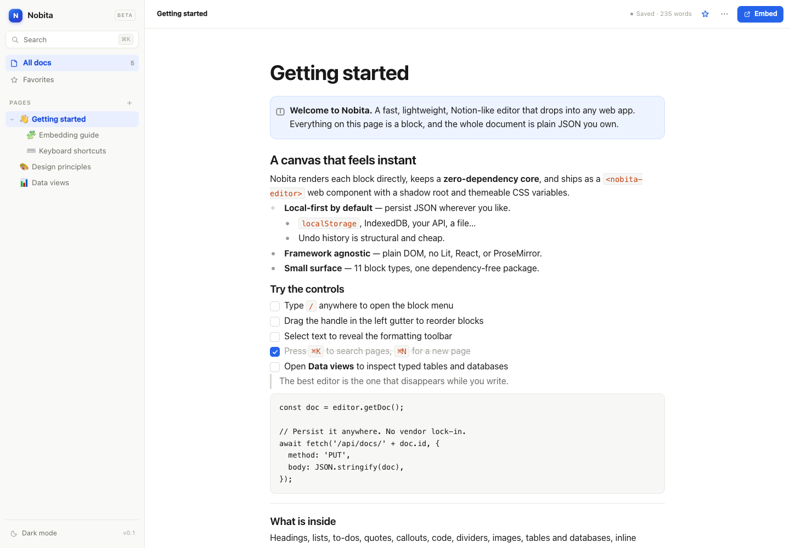
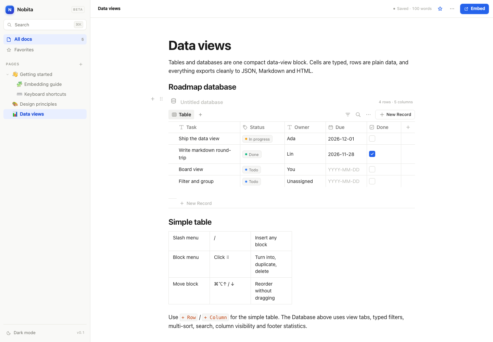

# Nobita

**A fast, lightweight, Notion-like block editor you can embed anywhere.**

Nobita is a from-scratch block editor built with **TypeScript 7.0.2**. It takes the interaction model people know from Notion and AFFiNE — blocks, a slash menu, a hover gutter, drag to reorder, markdown shortcuts — and packages it as a small, framework-free web component with plain JSON documents.

<p>
  
  
</p>
<p>
  
</p>
<p>
  
</p>

- **55.4 KB gzipped** standalone ESM bundle (minified, includes the core and data views).
- **Zero runtime dependencies** — no Lit, React, ProseMirror, Yjs, or virtual DOM.
- **Shadow DOM web component** — host styles cannot leak in, editor styles cannot leak out.
- **Plain JSON documents** — persist to localStorage, IndexedDB, your API, or a file.
- **Framework agnostic** — vanilla API, `<nobita-editor>`, and a thin React wrapper.
- **AFFiNE-informed, not an AFFiNE port** — see [the analysis](docs/affine-analysis.md).

## What works today

| Area | Included |
| --- | --- |
| Blocks | Text, headings 1–6, bulleted / numbered / to-do lists, quote, callout, code, divider, image, table/database |
| Inline | Bold, italic, underline, strikethrough, inline code, links, alignment, 8-color highlight and text-color palettes |
| Editing | Enter / Backspace / Delete merging, Tab indent, block move, undo / redo |
| Data views | Table and board views, filters, grouping, column resize, cell range copy/paste and TSV import; typed columns (text, number, select, multi-select, date, checkbox, URL, files, people), row menus, sort, Markdown table round-trip, HTML table paste/export |
| Menus | Slash menu with fuzzy search and block actions (move/copy), block handle menu, selection toolbar with Turn into / Align / format / Color, link popover |
| Drag | Reorder blocks, drop between blocks or nest into a block |
| Markdown | `# `, `- `, `1. `, `[] `, `> `, ` ``` `, `--- `, Markdown tables; inline `**bold**`, `*italic*`, `` `code` ``, `~~strike~~`, `[links](url)` |
| Clipboard | Rich HTML, Markdown, plain text, and a private `application/x-nobita+json` format |
| Persistence | JSON in / JSON out, `onChange`, `setDoc`, readonly mode, theming; optional `@nobita/storage` adapters for localStorage, SQLite/D1 and HTTP |
| A11y | Keyboard menus, labels, focus-visible states, `aria-pressed` toolbar |

Not in the box: multiple named saved views, synced blocks, comments, math, embeds, collaboration, image uploads (URLs only), and virtualization for very large documents. See [Roadmap](#roadmap).

## Quick start

```bash
pnpm install
pnpm dev          # demo at http://127.0.0.1:5173
pnpm test         # core + storage unit tests
pnpm typecheck    # TypeScript 7 project build
pnpm build        # packages + bundled editor + demo
```

### Web component

```html
<script type="module">
  import '@nobita/element'; // auto-defines <nobita-editor>

  const editor = document.querySelector('nobita-editor');
  editor.doc = await fetch('/doc.json').then(response => response.json());

  editor.addEventListener('nobita-change', event => {
    save(event.detail.doc);
  });
</script>

<nobita-editor theme="auto" placeholder="Type '/' for commands"></nobita-editor>
```

`packages/element/dist/nobita.js` is the standalone ESM build. `dist/nobita.global.js` is an IIFE for a plain `<script>` tag and exposes `window.Nobita`.

### Imperative API

```ts
import { createEditor } from '@nobita/element';
import type { Doc } from '@nobita/core';

const editor = createEditor(document.querySelector('#editor')!, {
  doc: await fetch('/doc.json').then(response => response.json()) as Doc,
  theme: 'light',
  placeholder: "Type '/' for commands",
  onChange(doc, meta) {
    localStorage.setItem('nobita-doc', JSON.stringify(doc));
  },
  onSelectionChange(selection) {
    console.log(selection);
  },
});

editor.focus();
editor.insertMarkdown('## Pasted markdown\n\n- becomes\n- blocks');
```

### React

```tsx
import { useRef } from 'react';
import { NobitaEditor, type NobitaReactHandle } from '@nobita/react';

export function Document() {
  const editor = useRef<NobitaReactHandle>(null);

  return (
    <NobitaEditor
      ref={editor}
      theme="auto"
      minHeight="480px"
      doc={initialDoc}
      onChange={doc => save(doc)}
    />
  );
}
```

The React wrapper only manages the host element; React never renders a block. That keeps typing off the React render path.

## Storage

The editor itself remains plain JSON in / JSON out. Nothing in `@nobita/element` imports a database, and the 55.4 KB bundle is unchanged.

`@nobita/storage` is an optional package for hosts that want a ready-made persistence port:

| Adapter | Use |
| --- | --- |
| `MemoryDocumentStore` | Tests, previews, ephemeral sessions |
| `LocalStorageDocumentStore` | `localStorage` / `sessionStorage` |
| `HttpDocumentStore` | Your API, including the Cloudflare D1 example |
| `SqlDocumentStore` | Local SQLite and Cloudflare D1 through a small `SqlDriver` |

```ts
import { LocalStorageDocumentStore } from '@nobita/storage';

const store = new LocalStorageDocumentStore();
const stored = await store.load('page-id');
await store.save(editor.getDoc(), {
  version: stored?.version ?? 0,
});
```

`version: 0` creates a document, a positive version enforces optimistic concurrency, and omitting it does a last-write-wins save. Each document stays one JSON value.

For Cloudflare D1, [examples/cloudflare-d1](examples/cloudflare-d1) contains a Worker, schema, D1 driver and browser client. Deployment steps and D1 limits are in [docs/storage.md](docs/storage.md).

## Document model

A document is deliberately simple, stable JSON:

```json
{
  "version": 1,
  "id": "d3f8k2",
  "title": "Hello",
  "icon": "👋",
  "blocks": [
    {
      "id": "b7k2m1",
      "type": "paragraph",
      "text": [
        { "text": "Hello " },
        { "text": "world", "marks": { "bold": true } }
      ],
      "props": {},
      "children": []
    }
  ]
}
```

- `text` is an array of runs. Each run has `text` and optional `marks`.
- `children` is a tree, used by nested lists and callouts.
- `props` is small and typed: heading `level`, todo `checked`, code `language`, callout `tone`, image `src` / `caption`, alignment, collapsed state.
- `parseDoc()` validates unknown JSON before it reaches the editor, deduplicates block ids, and fills defaults.

### Data views

A **Table** and a **Database** are the same `database` block with a different default schema (`props.database.variant`). Tables default to plain text columns; databases default to Name / Status / Due / Done properties.

```json
{
  "type": "database",
  "text": [],
  "props": {
    "database": {
      "variant": "database",
      "columns": [
        { "id": "c1", "name": "Task", "type": "text" },
        { "id": "c2", "name": "Status", "type": "select", "options": ["Todo", "Done"] },
        { "id": "c3", "name": "Due", "type": "date" },
        { "id": "c4", "name": "Done", "type": "checkbox" },
        { "id": "c5", "name": "Tags", "type": "multi-select", "options": ["Docs", "Release"] },
        { "id": "c6", "name": "Owner", "type": "people" }
      ],
      "rows": [
        {
          "id": "r1",
          "cells": {
            "c1": { "text": "Ship it" },
            "c2": { "text": "Done" },
            "c3": { "text": "2026-12-01" },
            "c4": { "checked": true },
            "c5": { "values": ["Docs", "Release"] },
            "c6": { "people": [{ "id": "u1", "label": "Ada" }] }
          }
        }
      ],
      "view": {
        "type": "board",
        "groupBy": "c2",
        "filters": [{ "columnId": "c2", "operator": "is", "value": "Todo" }],
        "sort": { "columnId": "c3", "direction": "asc" }
      }
    }
  },
  "children": []
}
```

Column types are `text`, `number`, `select`, `multi-select`, `date`, `checkbox`, `url`, `files` and `people`. Columns can persist a `width`; empty cells are omitted, so documents stay compact. `view` stores the table/board mode, filters, grouping and sort without reordering the underlying rows. Markdown exports render a standard pipe table; pasting a Markdown, HTML or TSV table creates/updates cells.

## API

See [docs/public-api.md](docs/public-api.md) for the stable import surface, editor options, events and internal-module boundary.

### `NobitaEditor`

| Member | Description |
| --- | --- |
| `getDoc()` | Current immutable document |
| `getJSON(pretty?)` | Serialize the document |
| `getMarkdown()` / `getHTML()` | Export helpers |
| `setDoc(doc, { history? })` | Replace the document |
| `setTitle(title)` | Update only the title |
| `getSelection()` | Current block/offset selection or `null` |
| `focus(blockId?, offset?)` | Focus the editor or a block |
| `focusTitle()` / `blur()` | Focus control |
| `undo()` / `redo()` | History |
| `setReadonly(value)` / `setTheme(theme)` | Runtime configuration |
| `insertMarkdown(markdown)` | Insert blocks at the caret |
| `destroy()` | Remove listeners and DOM |

Options: `doc`, `readonly`, `theme` (`light` / `dark` / `auto`), `placeholder`, `autofocus`, `spellcheck`, `historyLimit`, `onChange(doc, { source })`, `onSelectionChange(selection)`.

The placeholder behaves like AFFiNE: it appears only on the **focused empty paragraph** (or heading, which shows “Heading 1/2/3/4/5/6”), and disappears as soon as text exists or focus leaves the body. It is not shown while the page title is focused. The default is `Type '/' for commands`; set `placeholder` to override the paragraph text.

### `<nobita-editor>`

Attributes: `readonly`, `theme`, `placeholder`, `min-height`, `doc` (JSON string).
Properties: `doc`, `value` (JSON), `markdown`, `editor`.
Methods: `focus()`, `undo()`, `redo()`, `getMarkdown()`, `getJSON()`, `setReadonly()`, `setTheme()`.
Events: `nobita-change` (`{ doc, source }`), `nobita-selection` (`{ selection }`), `nobita-ready`.

Use `doc` as a property for normal use. Set `doc` **before** the element connects, or use the property after mount; the element keeps the last document across disconnect/reconnect.

### Theming

Every visual token is a CSS custom property on the host element:

| Variable | Purpose |
| --- | --- |
| `--nb-font`, `--nb-mono` | Font families |
| `--nb-bg`, `--nb-surface`, `--nb-bg-subtle`, `--nb-hover` | Surfaces |
| `--nb-text`, `--nb-text-secondary`, `--nb-text-tertiary`, `--nb-text-placeholder` | Ink |
| `--nb-border`, `--nb-border-strong` | Rules |
| `--nb-accent`, `--nb-accent-soft`, `--nb-selection` | Accent and selection |
| `--nb-code-bg` | Code block background |
| `--nb-hl-{red,orange,yellow,green,teal,blue,purple,grey}` | Inline highlight palette |
| `--nb-fg-{red,orange,yellow,green,teal,blue,purple,grey}` | Inline text-color palette |
| `--nb-shadow`, `--nb-shadow-lg` | Chrome |
| `--nb-page-width`, `--nb-page-padding-y`, `--nb-page-padding-x` | Page geometry |
| `--nb-db-bleed` | Optional horizontal bleed for root data views (`0` by default) |
| `--nb-min-height` | Minimum editor height |

```css
nobita-editor {
  --nb-font: 'Newsreader', Georgia, serif;
  --nb-accent: #0f766e;
  --nb-page-width: 760px;
}
```

Dark mode is built in (`theme="dark"` or `auto`). The shadow root uses `color-scheme`, so native controls follow the theme.

## Testing

Unit, type and browser regression checks, plus size and performance baselines, are documented in [docs/testing.md](docs/testing.md).

```bash
pnpm test:browser
pnpm size
pnpm bench
```

## Performance

Measured in headless Chrome 158 on the development host, production build:

| Blocks | Initial render | Keystroke (synthetic `beforeinput`, median) |
| --- | ---: | ---: |
| 200 | 11 ms | 0.4 ms |
| 1,000 | 20 ms | 0.9 ms |
| 3,000 | 35 ms | 3.5 ms |

A 100-row × 6-column data view renders in about **12 ms**. Data-view cell edits are in-place and do not rebuild the grid.

Bundle sizes:

| Artifact | Raw | Gzip |
| --- | ---: | ---: |
| Editor ESM (`nobita.js`) | 200.8 KB | **55.4 KB** |
| Demo app (editor + UI + seed data) | 231.0 KB | 65.4 KB |

The optional `@nobita/storage` package is not part of either bundle; it is only present when a host imports it.

Why it stays small: immutable path-copy updates mean undo is a pointer swap; per-block DOM views are patched by reference; no framework runtime ships; the renderer never re-renders unchanged blocks. See [architecture](docs/architecture.md).

The numbers are directional, not a guarantee: keystroke timing excludes OS/browser key dispatch and paint.

## Repository layout

```
packages/core      Document model, commands, markdown, JSON validation, history — no DOM
packages/element   Editor engine, block views, selection, menus, toolbar, web component
packages/react     Thin React host wrapper
packages/storage   Optional persistence port and adapters (localStorage, SQLite/D1, HTTP)
apps/demo          Notion-like demo: sidebar, pages, search, export, embed dialog
examples/          Optional integrations, including the Cloudflare D1 Worker
docs/              AFFiNE analysis, architecture and storage notes
```

## Design notes

Nobita began with an analysis of AFFiNE 0.27.x, both the live app and the BlockSuite source. The useful lessons were the block schema tree, delta-based rich text, a single command layer behind every menu and hotkey, and overlay chrome. The deliberate divergences are a dependency-free core, direct DOM rendering, and one editing host per shadow root.

That last point matters: Chromium clamps ranges that span separate `contenteditable` elements inside a shadow root. To get real cross-block selection, formatting, copy and delete, Nobita places all blocks inside **one** contenteditable body while keeping per-block rendering and a block/offset selection model. The trade-off and internals are documented in [docs/architecture.md](docs/architecture.md).

Data views follow the same rule: one `database` block, a narrow nested editing host for each cell, a structural-key check to avoid rebuilding the grid while typing, and plain row JSON. No grid library is shipped.

A command-by-command comparison with AFFiNE, including recommended P0/P1 additions, is in [docs/command-comparison.md](docs/command-comparison.md).

## Roadmap

- Block links, mentions, and nested pages inside the editor.
- Collaboration adapter (Yjs/Automerge) behind an explicit interface.
- Virtualized rendering for 10k+ block documents.
- Image upload / paste, code language picker, callout tone picker.
- Vue/Svelte wrappers (the web component already works in both).
- Published packages and CDN builds.

## License

MIT. See [LICENSE](LICENSE).
